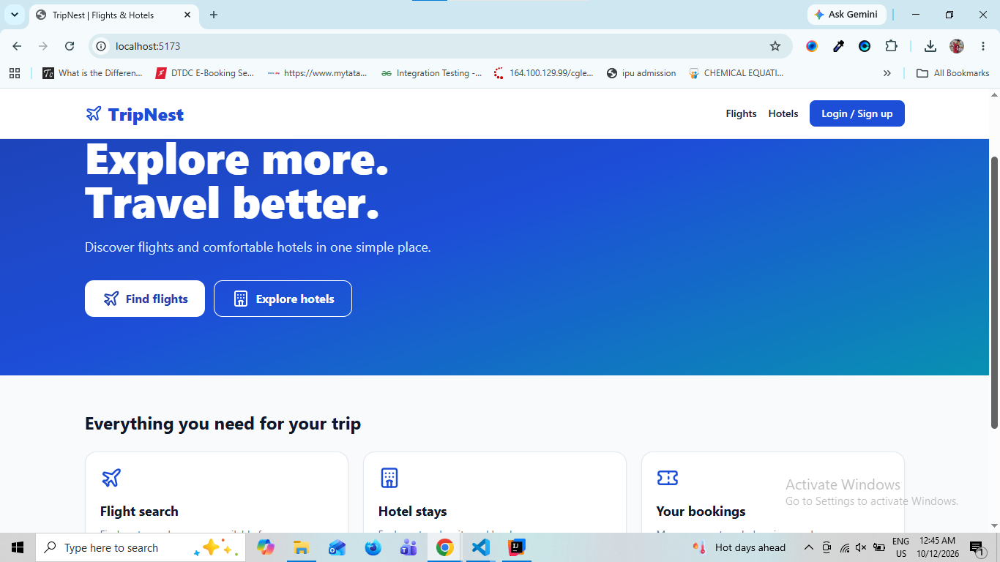
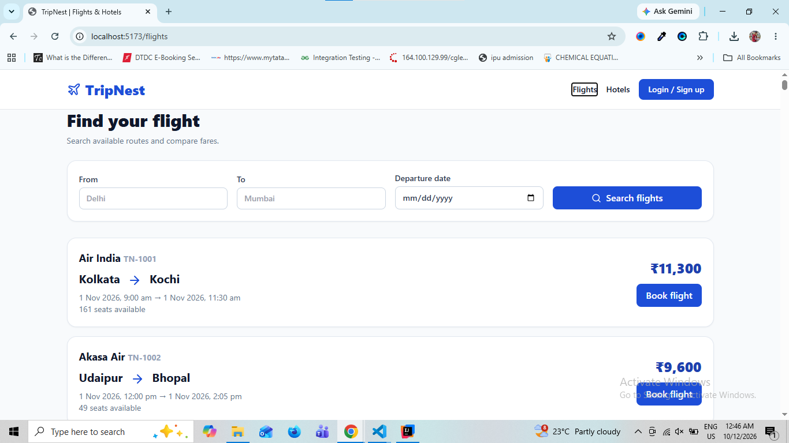
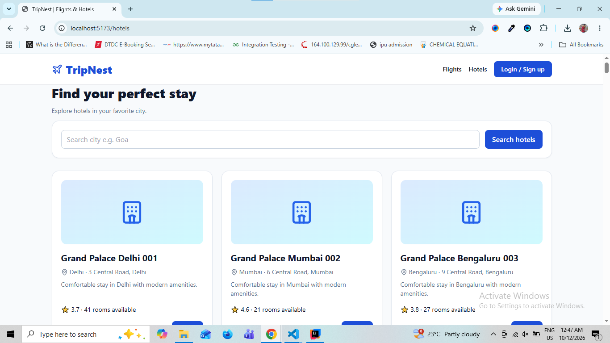
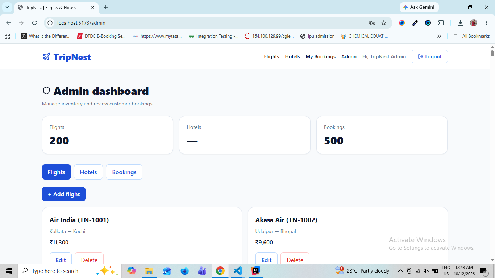

# TripNest — Travel Booking System

A full-stack travel booking application inspired by MakeMyTrip. TripNest allows customers to browse flights and hotels, make reservations, review booking history, and cancel bookings. An admin dashboard provides tools to manage travel listings and bookings.

## Tech Stack

| Layer | Technologies |
| --- | --- |
| Frontend | React.js, JavaScript, Tailwind CSS, Vite |
| Backend | Java 17, Spring Boot, Spring Security, REST APIs |
| Database | MySQL, Spring Data JPA, Hibernate |
| Authentication | JWT, BCrypt password hashing, role-based access control |
| Tools | Maven, Git, GitHub, Postman |

## Features

### Customer
- Register and sign in with JWT-based authentication.
- Browse and search available flights and hotels.
- Create flight and hotel bookings.
- View personal booking history.
- Cancel existing bookings.

### Admin
- Sign in with an administrator account.
- Add, view, update, and delete flights and hotels.
- Manage customer bookings through the admin dashboard.
- Access protected admin functionality through role-based authorization.

## Project Structure

```text
TripNest-Java/
├── TripNest_Backend/       # Spring Boot API
├── TripNest_Frontend/      # React application
├── screenshots/
└── README.md
```

## Getting Started

### Prerequisites
- Java 17+
- Maven (or the Maven wrapper included with the backend)
- Node.js and npm
- MySQL 8+

### 1. Clone the repository

```bash
git clone https://github.com/ShivamPandey-FSD/TripNest-Java.git
cd TripNest-Java
```

### 2. Set up MySQL

Create the database (the backend can also create it when configured to do so):

```sql
CREATE DATABASE IF NOT EXISTS tripnest_db;
```

Configure the backend's `src/main/resources/application.properties` or provide the environment variables below:

```properties
spring.datasource.url=${DB_URL:jdbc:mysql://localhost:3306/tripnest_db?createDatabaseIfNotExist=true}
spring.datasource.username=${DB_USERNAME:root}
spring.datasource.password=${DB_PASSWORD:}
spring.jpa.hibernate.ddl-auto=update
app.jwt.secret=${JWT_SECRET}
app.cors.origin=${FRONTEND_URL:http://localhost:5173}
app.seed.enabled=${SEED_ENABLED:false}
```

**Security:** Supply a strong `JWT_SECRET` and your MySQL credentials through environment variables or local configuration. Never commit real passwords, production secrets, or `.env` files. The settings above are an example; keep the remaining properties required by your application.

### 3. Run the backend

```bash
cd tripnest-backend
./mvnw spring-boot:run
```

On Windows, use `mvnw.cmd spring-boot:run`. If no Maven wrapper is present, use `mvn spring-boot:run`.

Backend default URL: `http://localhost:8080`

### 4. Run the frontend

Open a second terminal in the repository root:

```bash
cd tripnest-frontend
npm install
npm run dev
```

Frontend default URL: `http://localhost:5173`

Make sure the frontend's API base URL points to the running backend.

## Application Workflow

1. A customer registers or logs in.
2. The customer browses flight or hotel listings and creates a booking.
3. Bookings appear in the customer's booking history and can be cancelled.
4. An admin manages flight listings, hotel listings, and customer bookings.

## Database Entities

- **User** — account details, BCrypt-hashed password, and `ADMIN` / `CUSTOMER` role.
- **Flight** — airline, route, schedule, fare, and available seats.
- **Hotel** — name, location, nightly rate, rating, and available rooms.
- **Booking** — customer, flight or hotel reference, booking type, quantity, price, status, and hotel stay dates where applicable.

Booking types: `FLIGHT`, `HOTEL`. Booking statuses: `CONFIRMED`, `CANCELLED`.

## API and Testing

The backend exposes REST APIs for authentication, flight and hotel listings, and booking management. Use Postman to test the routes implemented in your controllers. Protected endpoints require a JWT token, and administrator actions require the `ADMIN` role.

## Screenshots (Optional)

### TripNest Homepage


### Flight Search


### Hotel Search


### Admin Dashboard


## Possible Future Improvements

- Online payment integration.
- Booking confirmation notifications.
- Advanced search filters and pagination.
- Automated integration tests and deployment.

## Author

**Shivam Pandey**

- GitHub: [ShivamPandey-FSD](https://github.com/ShivamPandey-FSD)
- LinkedIn: [Shivam Pandey](https://www.linkedin.com/in/shivam-pandey-37779934a/)

---
